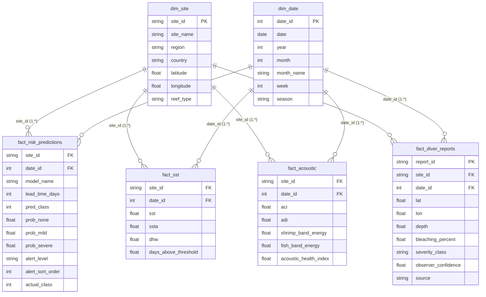

# CoralGuard Power BI Data Model Specification

## 1. Architectural Pattern: Star Schema
The semantic model follows an enterprise **Star Schema** architecture optimized for VertiPaq compression, rapid DAX aggregations, and intuitive business self-service:
- **Dimensions (`1`):** `dim_site`, `dim_date`
- **Facts (`*`):** `fact_risk_predictions`, `fact_sst`, `fact_acoustic`, `fact_diver_reports`
- **Disconnected Reference Tables:** `model_metrics`, `feature_importance`
- **Filter Direction:** Strictly **Single (1 -> *)**, pointing from Dimensions down to Fact tables.
- **Date Table:** `dim_date` is configured as the official Date Table via column `dim_date[date]`.

---

## 2. Mermaid Entity-Relationship Diagram

---

## 3. Relationships Definition Matrix

| From Dimension (1) | Primary Key | To Fact Table (*) | Foreign Key | Cardinality | Cross-filter | State |
|---|---|---|---|---|---|---|
| `dim_site` | `site_id` | `fact_risk_predictions` | `site_id` | 1 to Many (`1:*`) | Single (`dim_site` -> Fact) | Active |
| `dim_site` | `site_id` | `fact_sst` | `site_id` | 1 to Many (`1:*`) | Single (`dim_site` -> Fact) | Active |
| `dim_site` | `site_id` | `fact_acoustic` | `site_id` | 1 to Many (`1:*`) | Single (`dim_site` -> Fact) | Active |
| `dim_site` | `site_id` | `fact_diver_reports` | `site_id` | 1 to Many (`1:*`) | Single (`dim_site` -> Fact) | Active |
| `dim_date` | `date_id` | `fact_risk_predictions` | `date_id` | 1 to Many (`1:*`) | Single (`dim_date` -> Fact) | Active |
| `dim_date` | `date_id` | `fact_sst` | `date_id` | 1 to Many (`1:*`) | Single (`dim_date` -> Fact) | Active |
| `dim_date` | `date_id` | `fact_acoustic` | `date_id` | 1 to Many (`1:*`) | Single (`dim_date` -> Fact) | Active |
| `dim_date` | `date_id` | `fact_diver_reports` | `date_id` | 1 to Many (`1:*`) | Single (`dim_date` -> Fact) | Active |

---

## 4. Modeling Best Practices Implemented
1. **Integer Date Keys:** All fact-to-calendar relationships leverage 8-digit integer keys (`YYYYMMDD`), minimizing memory footprint and maximizing VertiPaq query throughput.
2. **Sort by Column:** 
   - `fact_risk_predictions[alert_level]` sorted by `fact_risk_predictions[alert_sort_order]`.
   - `dim_date[month_name]` sorted by `dim_date[month]`.
3. **Data Categories:**
   - `dim_site[latitude]` categorized as **Latitude**.
   - `dim_site[longitude]` categorized as **Longitude**.
   - `dim_site[country]` categorized as **Country/Region**.
4. **Mark as Date Table:** `dim_date` marked as Date Table using column `date`.

